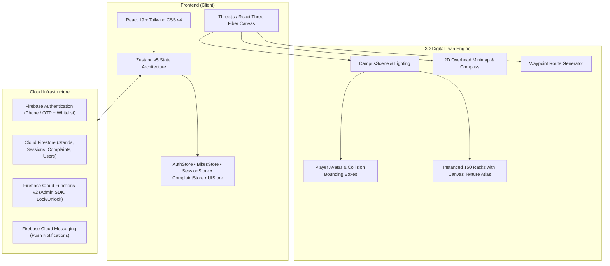

#  ParkShark — Smart Bicycle Management & 3D Campus Explorer
> **An intelligent, IoT-ready bicycle parking platform and 3D digital twin campus navigation system for VIT Bhopal University.**

[](https://react.dev/)
[](https://threejs.org/)
[](https://vitejs.dev/)
[](https://tailwindcss.com/)
[](https://firebase.google.com/)
[](https://nodejs.org/api/test.html)
[](https://www.typescriptlang.org/)

---

##  The Story Behind ParkShark

Every morning across the sprawling 250-acre campus of VIT Bhopal University, thousands of students rush to academic blocks like AB 1, AB 2, and AB 3 on bicycles. Finding an open bicycle stand right before an 8:30 AM class is a chaotic scramble. Racks overflow, bicycles get parked randomly or double-locked, and after class, locating where you parked among hundreds of identical cycles feels like searching for a needle in a haystack.

**ParkShark** was built to solve this exact problem from the ground up:

1. **Before you arrive**, you open a 3D digital twin of the campus to see live, color-coded occupancy across every bicycle stand.
2. **On your way**, ParkShark traces an optimal walking or riding path directly to an open slot, complete with distance metrics and an auto-navigation guide.
3. **When you park**, you scan the QR code beside the stand, enter a 4-digit security PIN, and the smart lock locks into place in an isolated, race-condition-safe transaction.
4. **During class**, you track your active session countdown in real-time, receiving automated 10-minute push notifications before your slot expires.
5. **If anything goes wrong** (jammed lock, damaged stand, or unreadable QR code), you can file an incident report with photos right from your phone, which routes straight to the campus facilities team.

---

## Core Features

### 1.  3D Digital Twin Campus (Three.js & React Three Fiber)
- **High-Performance Procedural Rendering**: 150 smart bicycle slots (`AB1-01` to `AB1-50`, `AB2-01` to `AB2-50`, `AB3-01` to `AB3-50`) rendered using single-draw-call `THREE.InstancedMesh` with a dynamic 2D canvas texture atlas displaying slot numbers and live availability colors.
- **Physics & Collision Engine**: Third-person player avatar with smooth WASD movement, continuous cylinder-to-AABB collision response, simulated gravity, sprinting, jumping, and mouse/pointer-drag camera orbit.
- **2D Canvas Minimap & Rotating Compass HUD**: Real-time overhead minimap tracing the avatar’s live coordinates (`sim.x`, `sim.z`) with heading indication and destination target beacons.
- **Proximity Scanner Prompt**: Automatically detects when you are within 2.5 metres of a stand, presenting an interactive prompt (`Press E to Scan / Tap to Lock`).
- **3D Heatmap Density Overlay**: An interactive toggle visualizing rack utilization density across campus (cold blue → warm yellow → peak red) so facilities managers can identify congestion hotspots at a glance.

### 2.  Waypoint Navigation & Auto-Walk Engine
- **Ground Route Projection**: Renders a glowing 3D polyline path on the campus terrain guiding you directly from your current position to your selected bicycle stand.
- **Live Walking Telemetry**: Automatically calculates 2D Euclidean distance, estimated walking duration based on a realistic 1.3 m/s campus pace, and digital time remaining.
- **Hands-Free Auto-Walk**: One-click autonavigation smoothly steers your avatar along path waypoints straight to the bike stand.
- **Dynamic Rerouting**: If someone locks into your targeted stand while you are walking toward it, ParkShark instantly detects the status change and suggests the next nearest available stand.

### 3.  Smart QR IoT Locking System
- **Dual Verification (Camera + Manual Input)**: Integrated `html5-qrcode` scanner with camera feed preview and full manual stand ID / PIN entry fallback.
- **Salted SHA-256 Security Hash**: Four-digit security PINs are hashed with stand-specific salts before persisting, safeguarding against tampering or client-side inspection.
- **Concurrency & Race Condition Prevention**: Locking actions run through isolated atomic transactions ensuring two students can never lock the same stand simultaneously.
- **Physical QR Placard Generation**: Every stand in the 3D world is accompanied by an exact replica of the physical QR placard installed beside real-world bicycle stands.
- **Admin Printable Placards Suite (`/admin/qrcodes`)**: A dedicated portal allowing facilities staff to search, filter by academic block, and print batch-ready QR codes for all 150 stands with a clean print stylesheet.

### 4.  Active Parking Sessions, Expiry Timers & Push Alerts
- **Dynamic Session Dashboard**: An interactive SVG circular progress ring and digital timer showing exact hours, minutes, and seconds remaining.
- **10-Minute Expiry Warnings**: An in-app warning banner triggers when under 10 minutes remain, paired with browser Web Push notifications via Firebase Cloud Messaging (FCM).
- **Grace Period & Auto-Release**: When a session expires, the stand automatically updates to available, freeing the slot for other students.
- **Anti-Theft Rate Limiting**: The 4-digit unlock verification enforces a strict 5-attempt threshold. Five incorrect attempts trigger an immediate 5-minute security lockout with a live cooldown timer.

### 5.  Student Complaint & Incident Reporting Portal (`/complaints`)
- **Five Categorized Issue Types**:
  -  Jammed Smart Lock
  -  Damaged Bicycle Stand / Rack
  -  Unreadable / Defaced QR Code
  -  Mobile App / Session Bug
  -  Billing or Duration Dispute
- **Photo Upload & Previews**: Attach photo evidence (simulated camera capture or image file upload) to give campus maintenance instant visual context.
- **Ticket Tracking ("My Complaints")**: Students receive a unique ticket ID (e.g. `#TKT-1042-841`) to track live statuses (`Pending Review` → `Under Investigation` → `Resolved` / `Closed`) with facilities team resolution notes.

### 6.  Admin Facilities Control Center (`/admin`)
- **Real-Time Analytics & Occupancy KPIs**: Live count of total slots (150), occupied racks, open stands, and percentage occupancy breakdown for AB1, AB2, and AB3.
- **Active Sessions Monitor**: Real-time directory of every student currently parked, allotted duration, and one-click administrative **Force-Release** for emergencies.
- **Maintenance Overrides**: Instantly toggle any stand into maintenance mode (`unavailable`) to prevent students from parking in damaged racks.
- **Bulk Student CSV Registration**: Drag-and-drop CSV importer allowing administrators to whitelist new student admissions in seconds, complete with a template downloader and live preview table.
- **Integrated Complaints Workspace**: Review open student incident reports, assign technicians, update ticket statuses, and write resolution logs that sync back to the student's dashboard.

### 7.  Dual-Theme Engine (Light & Dark Mode)
- **Zero Inversion Glitches**: Engineered from the ground up for high-contrast accessibility (WCAG AA compliant).
- **Crisp Adaptive Surfaces**: Cards, modals, buttons, and HUD controls smoothly transition between clean frosted glass (`bg-white/95 text-slate-900`) and deep navy midnight (`bg-slate-900/90 text-slate-100`).
- **Adaptive Sticky Navigation**: Top Header and bottom mobile navigation bar maintain precise z-index isolation and height offsets, guaranteeing zero layout overlap.

---

##  Architecture & Tech Stack



### Technology Highlights
- **Core Framework**: React 19 (`19.2.0`) + Vite 8 (`8.2.0`)
- **3D Graphics**: Three.js (`0.186.1`), `@react-three/fiber` (`9.8.2`), `@react-three/drei` (`10.7.9`)
- **Styling**: Tailwind CSS v4 (`4.3.0`), Lucide React icons (`0.510.0`), Radix UI primitives
- **State Management**: Zustand v5 (`5.0.0`) with persistence middleware
- **Backend & Cloud**: Firebase v13 (`13.1.0`), Cloud Firestore, Firebase Auth with reCAPTCHA, Firebase Cloud Functions v2
- **Testing**: Node.js Native Test Runner with TypeScript compilation (`84 tests, 0 failures`)

---

##  Repository Directory Structure

```text
ParkShark/
├── AEl0wwzRqWIYWHjt-grok-workspace/
│   ├── src/
│   │   ├── campus/                    # 3D Scene, Physics & World Coordinates
│   │   │   ├── CampusScene.tsx        # Environment lighting, sky, ground, structures
│   │   │   ├── BikeRacks.tsx          # 150 Instanced bicycle racks & texture atlas
│   │   │   ├── Player.tsx             # 3D avatar, physics, running, jumping, camera
│   │   │   ├── world.ts               # Coordinates, bounding boxes, collision math
│   │   │   ├── Hud.tsx                # Minimap, rotating compass, place banner
│   │   │   ├── NavigationPath.tsx     # 3D polyline route renderer
│   │   │   └── sim.ts                 # High-frequency shared telemetry state
│   │   │
│   │   ├── components/                # Reusable UI & Layout Components
│   │   │   ├── AppShell.tsx           # Main application layout, routing & header
│   │   │   ├── ui/                    # Design system components
│   │   │   │   ├── Button.tsx         # Primary, outline, secondary, ghost buttons
│   │   │   │   ├── Card.tsx           # Adaptive light/dark glass card container
│   │   │   │   ├── Header.tsx         # Sticky brand header, user greeting, role badge
│   │   │   │   ├── BottomTabBar.tsx   # Mobile navigation bar (Campus, Tracer, Places...)
│   │   │   │   ├── Modal.tsx          # Accessible modal dialog with Esc / backdrop dismiss
│   │   │   │   ├── Input.tsx          # Form input with floating labels & error states
│   │   │   │   ├── StatusPill.tsx     # Available / Occupied / Maintenance badges
│   │   │   │   └── LocationTracerModal.tsx # Nearest bicycle stand locator popup
│   │   │
│   │   ├── pages/                     # Application Screen Views
│   │   │   ├── LoginScreen.tsx        # Whitelist OTP login with video background
│   │   │   ├── CampusScreen.tsx       # Primary 3D view with building occupancy chips
│   │   │   ├── NavigationScreen.tsx   # Waypoint navigation, telemetry & arrival trigger
│   │   │   ├── LockScreen.tsx         # Camera QR scanner, PIN entry & lock transaction
│   │   │   ├── SessionScreen.tsx      # SVG circular countdown timer & 10-min alerts
│   │   │   ├── UnlockScreen.tsx       # PIN verification with 5-attempt rate lockout
│   │   │   ├── DashboardScreen.tsx    # Student profile, session history, impact stats
│   │   │   ├── ComplaintsScreen.tsx   # File complaint tickets & history tracking
│   │   │   ├── AdminScreen.tsx        # Analytics, force-release, CSV bulk upload, tickets
│   │   │   └── AdminQrCodesScreen.tsx # Batch printable QR placards for all 150 stands
│   │   │
│   │   ├── services/                  # Business Logic, Firestore & Cloud Functions
│   │   │   ├── authService.ts         # Pre-registered student lookup & OTP flow
│   │   │   ├── lockService.ts         # Salted SHA-256 PIN hashing & atomic lock
│   │   │   ├── notificationService.ts # Web Push & 10-minute warning dispatch
│   │   │   └── firebase.ts            # Firebase app initialization & emulator hook
│   │   │
│   │   ├── store/                     # Zustand Centralized State Stores
│   │   │   ├── useAuthStore.ts        # Authenticated student & role management
│   │   │   ├── useBikesStore.ts       # 150 stands state, filtering & distance math
│   │   │   ├── useSessionStore.ts     # Active parking session, lockout, & ride history
│   │   │   ├── useComplaintStore.ts   # Incident reports, categories, & resolutions
│   │   │   └── useUIStore.ts          # Dark/Light theme toggle & global toast notifications
│   │   │
│   │   └── utils/
│   │       ├── distance.ts            # 2D Euclidean distance & nearest available stand
│   │       └── qr.ts                  # QR payload generation & stand verification
│   │
│   ├── scripts/                       # Migration, database seeds & environment loaders
│   ├── firestore.rules                # Production Firestore security rules
│   └── package.json                   # Project scripts and dependencies
│
└── README.md                          # Comprehensive project documentation
```

---

## Quickstart Guide

### Prerequisites
- **Node.js**: v20.x or higher installed ([Download Node.js](https://nodejs.org/))
- **npm**: v10.x or higher

### 1. Clone & Install Dependencies
```bash
# Navigate to the workspace directory
cd "AEl0wwzRqWIYWHjt-grok-workspace"

# Install all required dependencies
npm install
```

### 2. Run the Development Server
```bash
npm run dev
```
The application will launch on:
 **`http://localhost:8080/`**

### 3. Run Automated Tests
ParkShark includes a full suite of 84 automated unit and integration tests covering geometry math, race-condition locking transactions, brute-force lockout rate limiting, CSV parsers, complaint ticketing, and auth invariants:
```bash
npm test
```

### 4. Type Safety Verification
Verify strict TypeScript compilation with zero errors:
```bash
npm run typecheck
```

---

##  Testing & Pre-Registered Credentials

To make evaluation effortless without requiring live SMS delivery, ParkShark includes pre-seeded student whitelist records with instant quick-fill buttons on the login screen:

| Student Name | College ID | Registered Mobile | Test OTP Code | Default Role |
| :--- | :--- | :--- | :--- | :--- |
| **Arjun S.** | `21BCE1042` | `9876543210` | `123456` | Student |
| **Priya P.** | `21BCE1088` | `9876543211` | `123456` | Student |
| **Rohan V.** | `22BCE1984` | `9876543212` | `123456` | Student |

> **Pro Tip**: To test administrator features (such as Stand Force-Release, 3D Heatmap Toggle, CSV Student Bulk Uploader, or Complaint Resolution), navigate to the **Dashboard** and tap the **Role: Student / Admin** switcher button in the top profile card, or navigate directly to `/admin`.

---

##  Keyboard & Navigation Controls

| Key / Action | Function in 3D Campus |
| :--- | :--- |
| `W` / `Up Arrow` | Move forward |
| `S` / `Down Arrow` | Move backward |
| `A` / `Left Arrow` | Strafe left |
| `D` / `Right Arrow` | Strafe right |
| `Shift` (Hold) | Sprint (`8.8 m/s`) |
| `Space` | Jump |
| `E` | Quick-scan nearest bicycle rack when within 2.5 metres |
| `Mouse Drag` | Look around / rotate camera angle smoothly |
| `Touchpad / Touch` | Dual virtual joysticks for mobile / tablet devices |

---

##  Security Architecture

1. **Anti-Tampering Hash Model**: Bicycle security PINs are never saved in plain text. PINs are salted with individual stand IDs and converted to SHA-256 hashes before Firestore persistence.
2. **Race-Condition Safe Transactions**: All parking lock acquisitions use Firestore isolated transactions (`runTransaction`) which atomically check slot availability prior to committing. If two students tap "Lock Here" on the same millisecond, the second student's attempt is rejected gracefully with an immediate reroute suggestion.
3. **Brute-Force Rate Limiting**: If an unauthorized party tries guessing a 4-digit unlock PIN, attempts are tracked locally and cloud-side. After 5 consecutive failures, a 5-minute security lockout is applied.
4. **Whitelist Enrollment Guard**: Only students whose College IDs or phone numbers exist in the verified institutional database can authenticate, preventing external spam accounts.

---

## Contributing

Contributions to improve campus sustainability and bicycle accessibility at VIT Bhopal University are welcome!
1. Fork the Project
2. Create your Feature Branch (`git checkout -b feature/AmazingFeature`)
3. Commit your Changes (`git commit -m "feat: add AmazingFeature"`)
4. Push to the Branch (`git push origin feature/AmazingFeature`)
5. Open a Pull Request

---

##  License

Distributed under the **MIT License**. See `LICENSE` for more information.

---

<div align="center">
  <sub>Built  for the student community of <b>VIT Bhopal University</b>.</sub>
</div>
